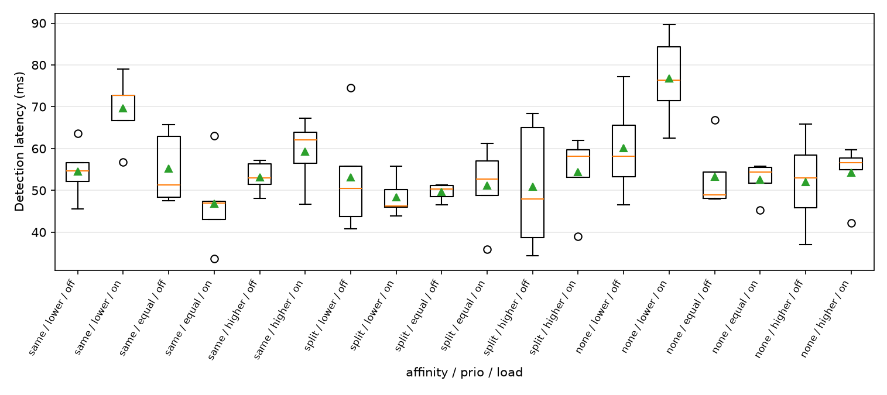
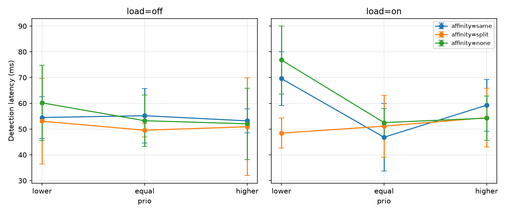
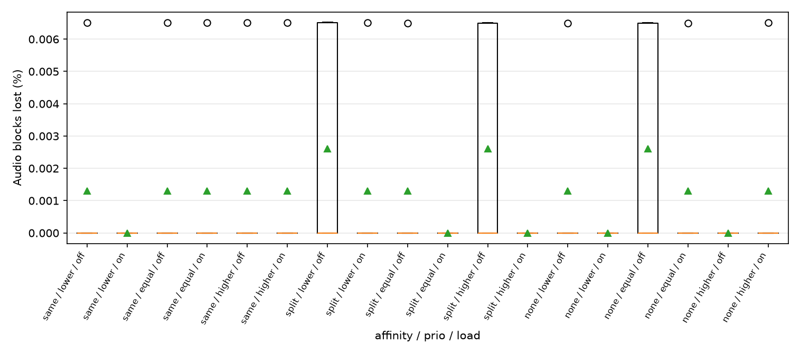
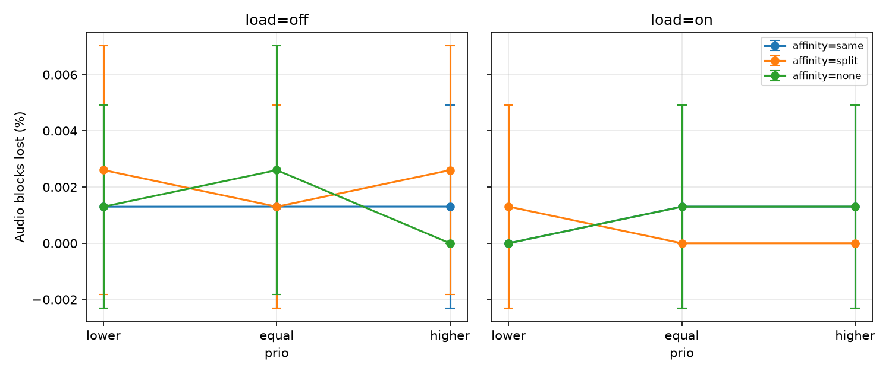
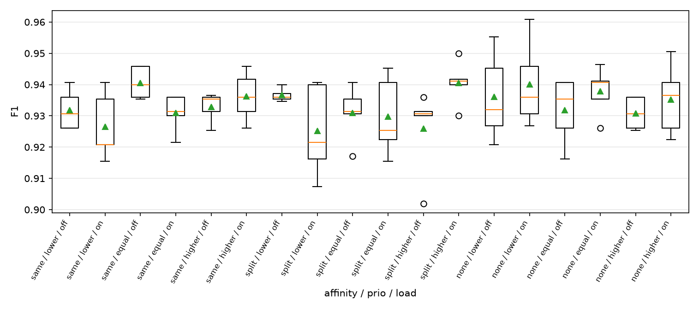
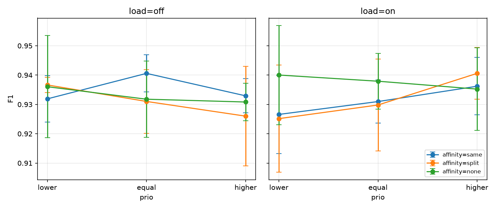

# Experiment A

Source: `..\experiments\results\A`. Factors: `affinity`, `prio`, `load`. Runs: 90 recorded, 90 ok (ok: 90). Each observation is the summary of one run (no pseudoreplication); failed runs are excluded.

## Detection latency (ms) (`det_latency_ms`)

### Descriptive statistics per treatment

| affinity | prio | load | n | mean | sd | ci95_low | ci95_high | p95 | max |
| --- | --- | --- | --- | --- | --- | --- | --- | --- | --- |
| same | lower | off | 5 | 54.5 | 6.551 | 46.36 | 62.63 | 62.18 | 63.57 |
| same | lower | on | 5 | 69.61 | 8.409 | 59.17 | 80.05 | 77.8 | 79.05 |
| same | equal | off | 5 | 55.2 | 8.517 | 44.62 | 65.77 | 65.19 | 65.76 |
| same | equal | on | 5 | 46.84 | 10.61 | 33.67 | 60.01 | 59.92 | 63.06 |
| same | higher | off | 5 | 53.2 | 3.717 | 48.58 | 57.81 | 56.99 | 57.15 |
| same | higher | on | 5 | 59.26 | 8.064 | 49.25 | 69.27 | 66.55 | 67.2 |
| split | lower | off | 5 | 53.06 | 13.32 | 36.52 | 69.61 | 70.75 | 74.48 |
| split | lower | on | 5 | 48.44 | 4.722 | 42.57 | 54.3 | 54.7 | 55.81 |
| split | equal | off | 5 | 49.57 | 2.064 | 47.01 | 52.13 | 51.3 | 51.32 |
| split | equal | on | 5 | 51.14 | 9.664 | 39.14 | 63.14 | 60.34 | 61.18 |
| split | higher | off | 5 | 50.91 | 15.27 | 31.95 | 69.87 | 67.72 | 68.4 |
| split | higher | on | 5 | 54.42 | 9.203 | 42.99 | 65.85 | 61.55 | 62 |
| none | lower | off | 5 | 60.17 | 11.78 | 45.55 | 74.8 | 74.86 | 77.17 |
| none | lower | on | 5 | 76.81 | 10.66 | 63.58 | 90.04 | 88.53 | 89.59 |
| none | equal | off | 5 | 53.25 | 8.032 | 43.28 | 63.23 | 64.33 | 66.81 |
| none | equal | on | 5 | 52.53 | 4.375 | 47.1 | 57.96 | 55.76 | 55.84 |
| none | higher | off | 5 | 52.05 | 11.16 | 38.19 | 65.91 | 64.42 | 65.91 |
| none | higher | on | 5 | 54.25 | 6.951 | 45.62 | 62.88 | 59.36 | 59.76 |

### Factorial ANOVA (with all interactions, Type III)

| term | df | sum_sq | F | p | partial_eta2 | significant |
| --- | --- | --- | --- | --- | --- | --- |
| affinity | 2 | 777.3 | 4.659 | 0.01251 | 0.1146 | True |
| prio | 2 | 1291 | 7.736 | 0.0009048 | 0.1769 | True |
| load | 1 | 273.4 | 3.277 | 0.07443 | 0.04353 | False |
| affinity x prio | 4 | 944.9 | 2.831 | 0.03064 | 0.1359 | True |
| affinity x load | 2 | 137 | 0.8209 | 0.4441 | 0.02229 | False |
| prio x load | 2 | 502.3 | 3.01 | 0.05552 | 0.07717 | False |
| affinity x prio x load | 4 | 720.8 | 2.16 | 0.08214 | 0.1071 | False |
| Residual | 72 | 6007 |  |  |  | False |

Assumptions: Shapiro-Wilk on residuals p = 0.318, Levene (median) p = 0.554 -> OK.

### Tukey HSD on significant terms

**affinity x prio**: 6 of 36 pairs differ ([all pairs](det_latency_ms_tukey_affinity_x_prio.csv)).

| group1 | group2 | mean_diff | p_adj | lower | upper | significant |
| --- | --- | --- | --- | --- | --- | --- |
| none / equal | none / lower | 15.6 | 0.0156 | 1.754 | 29.44 | True |
| none / higher | none / lower | 15.34 | 0.0187 | 1.497 | 29.18 | True |
| none / lower | same / equal | -17.47 | 0.0039 | -31.32 | -3.629 | True |
| none / lower | split / equal | -18.14 | 0.0023 | -31.98 | -4.293 | True |
| none / lower | split / higher | -15.82 | 0.0133 | -29.67 | -1.982 | True |
| none / lower | split / lower | -17.74 | 0.0032 | -31.58 | -3.896 | True |

**affinity**: 1 of 3 pairs differ ([all pairs](det_latency_ms_tukey_affinity.csv)).

| group1 | group2 | mean_diff | p_adj | lower | upper | significant |
| --- | --- | --- | --- | --- | --- | --- |
| none | split | -6.921 | 0.0362 | -13.48 | -0.361 | True |

**prio**: 2 of 3 pairs differ ([all pairs](det_latency_ms_tukey_prio.csv)).

| group1 | group2 | mean_diff | p_adj | lower | upper | significant |
| --- | --- | --- | --- | --- | --- | --- |
| equal | lower | 9.01 | 0.0033 | 2.623 | 15.4 | True |
| higher | lower | 6.418 | 0.0486 | 0.0307 | 12.8 | True |

## Audio blocks lost (%) (`loss_pct`)

### Descriptive statistics per treatment

| affinity | prio | load | n | mean | sd | ci95_low | ci95_high | p95 | max |
| --- | --- | --- | --- | --- | --- | --- | --- | --- | --- |
| same | lower | off | 5 | 0.0013 | 0.002908 | -0.00231 | 0.004911 | 0.005202 | 0.006502 |
| same | lower | on | 5 | 0 | 0 | 0 | 0 | 0 | 0 |
| same | equal | off | 5 | 0.001303 | 0.002914 | -0.002315 | 0.004921 | 0.005212 | 0.006515 |
| same | equal | on | 5 | 0.001303 | 0.002913 | -0.002314 | 0.004919 | 0.00521 | 0.006513 |
| same | higher | off | 5 | 0.001303 | 0.002914 | -0.002315 | 0.004921 | 0.005212 | 0.006515 |
| same | higher | on | 5 | 0.001302 | 0.002911 | -0.002312 | 0.004916 | 0.005207 | 0.006509 |
| split | lower | off | 5 | 0.002605 | 0.003567 | -0.001824 | 0.007033 | 0.006516 | 0.006519 |
| split | lower | on | 5 | 0.001303 | 0.002915 | -0.002315 | 0.004922 | 0.005214 | 0.006517 |
| split | equal | off | 5 | 0.001299 | 0.002905 | -0.002308 | 0.004906 | 0.005197 | 0.006496 |
| split | equal | on | 5 | 0 | 0 | 0 | 0 | 0 | 0 |
| split | higher | off | 5 | 0.002601 | 0.003561 | -0.001821 | 0.007023 | 0.006505 | 0.006507 |
| split | higher | on | 5 | 0 | 0 | 0 | 0 | 0 | 0 |
| none | lower | off | 5 | 0.0013 | 0.002906 | -0.002309 | 0.004908 | 0.005199 | 0.006498 |
| none | lower | on | 5 | 0 | 0 | 0 | 0 | 0 | 0 |
| none | equal | off | 5 | 0.002603 | 0.003564 | -0.001823 | 0.007029 | 0.006512 | 0.006515 |
| none | equal | on | 5 | 0.0013 | 0.002907 | -0.002309 | 0.00491 | 0.0052 | 0.0065 |
| none | higher | off | 5 | 0 | 0 | 0 | 0 | 0 | 0 |
| none | higher | on | 5 | 0.001303 | 0.002915 | -0.002315 | 0.004922 | 0.005214 | 0.006517 |

### Factorial ANOVA (with all interactions, Type III)

| term | df | sum_sq | F | p | partial_eta2 | significant |
| --- | --- | --- | --- | --- | --- | --- |
| affinity | 2 | 9.387e-07 | 0.06878 | 0.9336 | 0.001907 | False |
| prio | 2 | 9.377e-07 | 0.06871 | 0.9337 | 0.001905 | False |
| load | 1 | 1.691e-05 | 2.478 | 0.1198 | 0.03328 | False |
| affinity x prio | 4 | 2.169e-05 | 0.7946 | 0.5326 | 0.04228 | False |
| affinity x load | 2 | 8.453e-06 | 0.6194 | 0.5411 | 0.01691 | False |
| prio x load | 2 | 2.822e-06 | 0.2068 | 0.8137 | 0.005712 | False |
| affinity x prio x load | 4 | 1.412e-05 | 0.5173 | 0.7232 | 0.02794 | False |
| Residual | 72 | 0.0004913 |  |  |  | False |

Assumptions: Shapiro-Wilk on residuals p = 2.34e-11, Levene (median) p = 0.905 -> **not met**.

Kruskal-Wallis across treatments (non-parametric check): H = 10.5, p = 0.88.

No significant term at alpha = 0.05.

## F1 (`f1`)

### Descriptive statistics per treatment

| affinity | prio | load | n | mean | sd | ci95_low | ci95_high | p95 | max |
| --- | --- | --- | --- | --- | --- | --- | --- | --- | --- |
| same | lower | off | 5 | 0.9319 | 0.006337 | 0.924 | 0.9398 | 0.9397 | 0.9406 |
| same | lower | on | 5 | 0.9266 | 0.01077 | 0.9132 | 0.94 | 0.9395 | 0.9406 |
| same | equal | off | 5 | 0.9406 | 0.005101 | 0.9342 | 0.9469 | 0.9458 | 0.9458 |
| same | equal | on | 5 | 0.931 | 0.005901 | 0.9236 | 0.9383 | 0.936 | 0.936 |
| same | higher | off | 5 | 0.9329 | 0.004685 | 0.9271 | 0.9387 | 0.9365 | 0.9366 |
| same | higher | on | 5 | 0.9362 | 0.00788 | 0.9264 | 0.946 | 0.945 | 0.9458 |
| split | lower | off | 5 | 0.9366 | 0.002101 | 0.934 | 0.9392 | 0.9394 | 0.94 |
| split | lower | on | 5 | 0.9251 | 0.01474 | 0.9068 | 0.9434 | 0.9405 | 0.9406 |
| split | equal | off | 5 | 0.931 | 0.008731 | 0.9202 | 0.9419 | 0.9395 | 0.9406 |
| split | equal | on | 5 | 0.9298 | 0.01263 | 0.9141 | 0.9455 | 0.9443 | 0.9453 |
| split | higher | off | 5 | 0.926 | 0.01364 | 0.9091 | 0.9429 | 0.935 | 0.936 |
| split | higher | on | 5 | 0.9406 | 0.007119 | 0.9317 | 0.9494 | 0.9483 | 0.95 |
| none | lower | off | 5 | 0.936 | 0.01402 | 0.9186 | 0.9534 | 0.9532 | 0.9552 |
| none | lower | on | 5 | 0.94 | 0.01362 | 0.9231 | 0.9569 | 0.9578 | 0.9608 |
| none | equal | off | 5 | 0.9318 | 0.0105 | 0.9187 | 0.9448 | 0.9406 | 0.9406 |
| none | equal | on | 5 | 0.9379 | 0.007664 | 0.9284 | 0.9474 | 0.9453 | 0.9463 |
| none | higher | off | 5 | 0.9308 | 0.005117 | 0.9245 | 0.9372 | 0.936 | 0.936 |
| none | higher | on | 5 | 0.9352 | 0.01133 | 0.9212 | 0.9493 | 0.9485 | 0.9505 |

### Factorial ANOVA (with all interactions, Type III)

| term | df | sum_sq | F | p | partial_eta2 | significant |
| --- | --- | --- | --- | --- | --- | --- |
| affinity | 2 | 0.0002138 | 1.131 | 0.3282 | 0.03047 | False |
| prio | 2 | 1.742e-05 | 0.0922 | 0.912 | 0.002554 | False |
| load | 1 | 6.327e-06 | 0.06695 | 0.7966 | 0.000929 | False |
| affinity x prio | 4 | 0.0004004 | 1.059 | 0.3829 | 0.05559 | False |
| affinity x load | 2 | 0.0002853 | 1.51 | 0.2279 | 0.04024 | False |
| prio x load | 2 | 0.0005619 | 2.973 | 0.05745 | 0.07629 | False |
| affinity x prio x load | 4 | 0.0005222 | 1.382 | 0.2489 | 0.07128 | False |
| Residual | 72 | 0.006804 |  |  |  | False |

Assumptions: Shapiro-Wilk on residuals p = 0.929, Levene (median) p = 0.585 -> OK.

No significant term at alpha = 0.05.

## Proportions (quasi-binomial logistic regression)

### loss (`blocks_lost` / `blocks_total`)

| term | chi2 | df | p | significant |
| --- | --- | --- | --- | --- |
| affinity | 1.114e-06 | 2 | 1 | False |
| prio | 1.237e-06 | 2 | 1 | False |
| load | 4.763e-06 | 1 | 0.9983 | False |
| affinity x prio | 1.289e-05 | 4 | 1 | False |
| affinity x load | 2.562e-06 | 2 | 1 | False |
| prio x load | 2.474e-06 | 2 | 1 | False |
| affinity x prio x load | 1.221e-05 | 4 | 1 | False |

### missed keywords (`misses` / `keywords`)

| term | chi2 | df | p | significant |
| --- | --- | --- | --- | --- |
| affinity | 9.41 | 2 | 0.009048 | True |
| prio | 1.311 | 2 | 0.5193 | False |
| load | 0.0911 | 1 | 0.7628 | False |
| affinity x prio | 2.481 | 4 | 0.6481 | False |
| affinity x load | 6.179 | 2 | 0.04552 | True |
| prio x load | 3.647 | 2 | 0.1615 | False |
| affinity x prio x load | 1.32 | 4 | 0.8579 | False |
