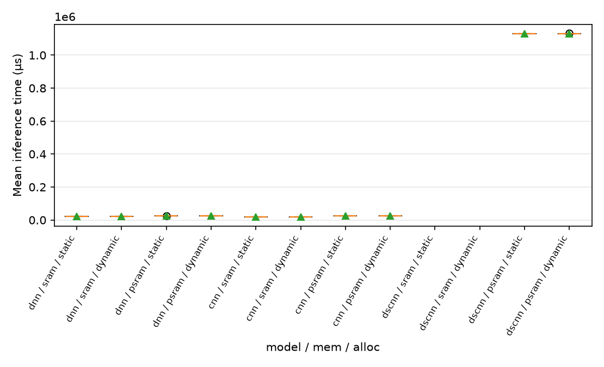
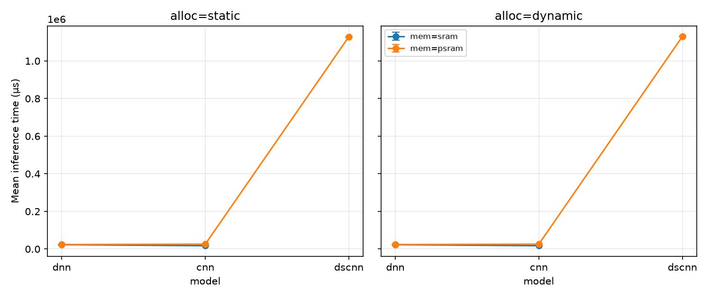
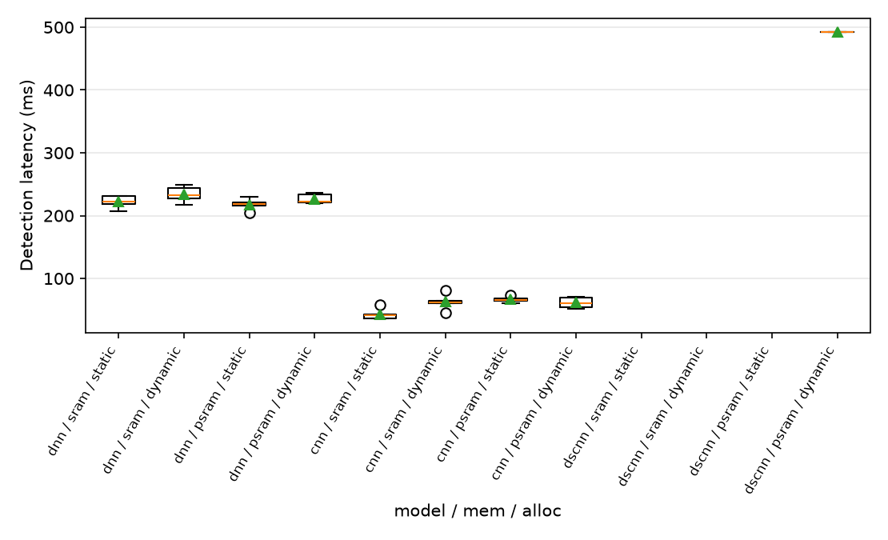
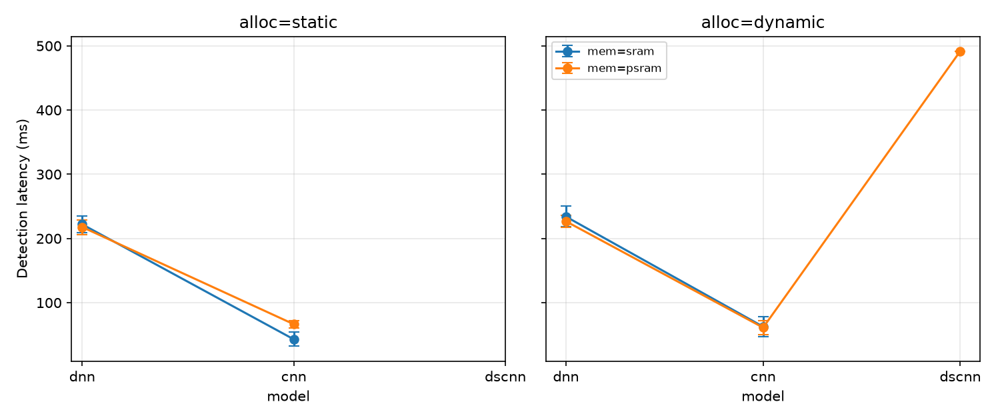
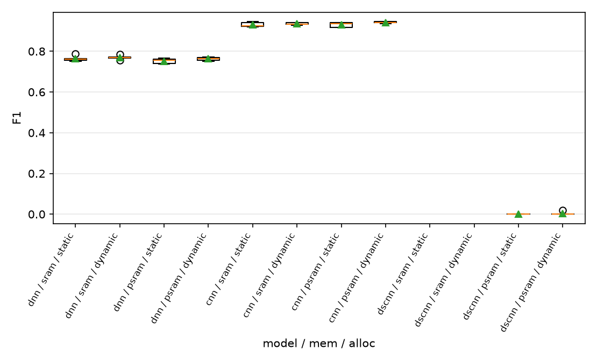
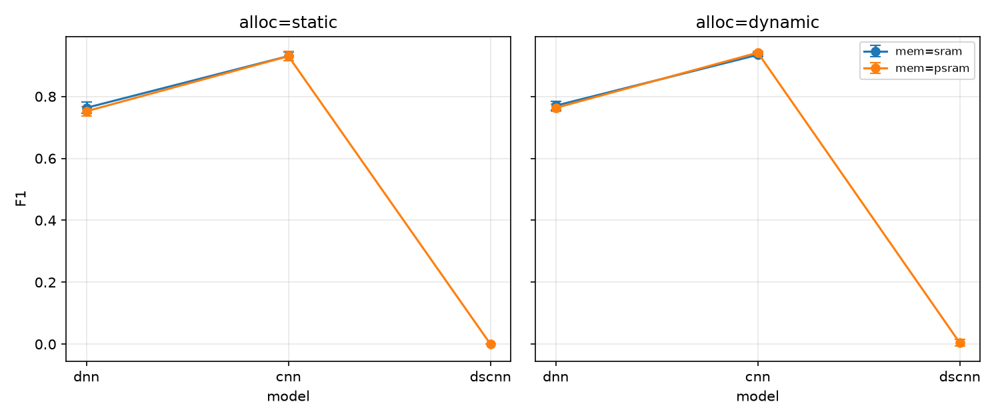
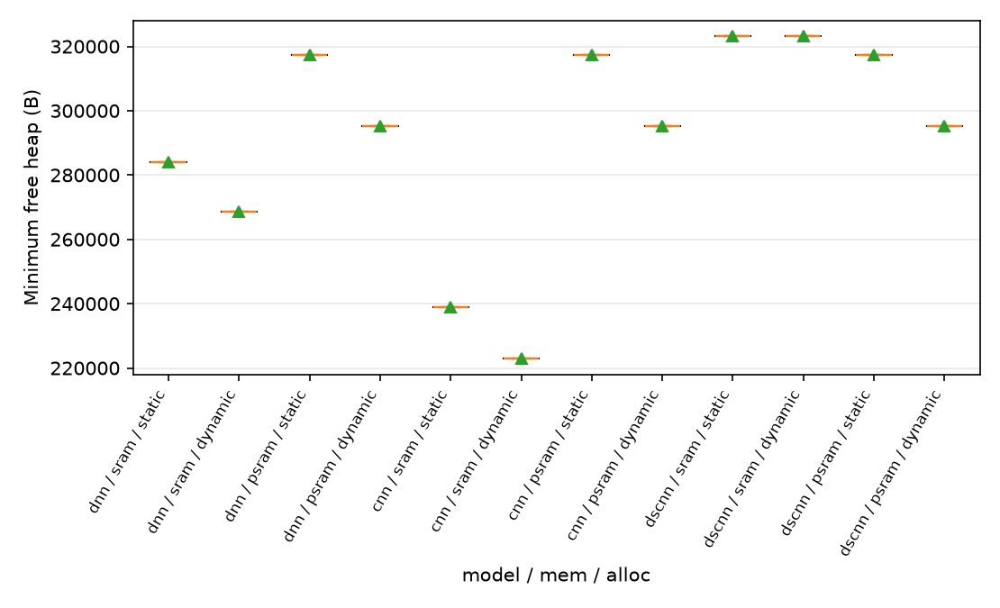
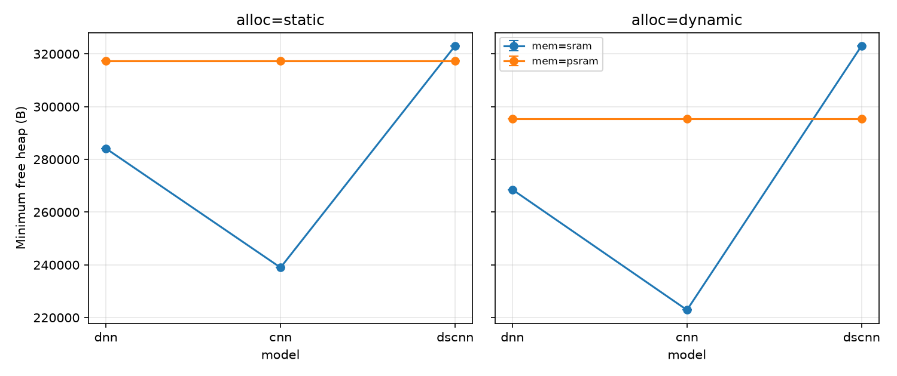

# Experiment B

Source: `..\experiments\results\B`. Factors: `model`, `mem`, `alloc`. Runs: 60 recorded, 60 ok (ok: 60). Each observation is the summary of one run (no pseudoreplication); failed runs are excluded.

**Allocation failures** (a result, not an error): dscnn / sram / static (5), dscnn / sram / dynamic (5)

## Mean inference time (µs) (`inf_mean_us`)

### Descriptive statistics per treatment

| model | mem | alloc | n | mean | sd | ci95_low | ci95_high | p95 | max |
| --- | --- | --- | --- | --- | --- | --- | --- | --- | --- |
| dnn | sram | static | 5 | 2.299e+04 | 1.304 | 2.299e+04 | 2.299e+04 | 2.299e+04 | 2.299e+04 |
| dnn | sram | dynamic | 5 | 2.3e+04 | 1.924 | 2.299e+04 | 2.3e+04 | 2.3e+04 | 2.3e+04 |
| dnn | psram | static | 5 | 2.36e+04 | 7.28 | 2.359e+04 | 2.361e+04 | 2.361e+04 | 2.361e+04 |
| dnn | psram | dynamic | 5 | 2.358e+04 | 1.581 | 2.358e+04 | 2.358e+04 | 2.358e+04 | 2.358e+04 |
| cnn | sram | static | 5 | 1.768e+04 | 1.414 | 1.768e+04 | 1.768e+04 | 1.768e+04 | 1.768e+04 |
| cnn | sram | dynamic | 5 | 1.768e+04 | 1.643 | 1.768e+04 | 1.768e+04 | 1.768e+04 | 1.768e+04 |
| cnn | psram | static | 5 | 2.576e+04 | 11.72 | 2.575e+04 | 2.578e+04 | 2.578e+04 | 2.578e+04 |
| cnn | psram | dynamic | 5 | 2.578e+04 | 6.943 | 2.577e+04 | 2.579e+04 | 2.579e+04 | 2.579e+04 |
| dscnn | sram | static | 0 |  |  |  |  |  |  |
| dscnn | sram | dynamic | 0 |  |  |  |  |  |  |
| dscnn | psram | static | 5 | 1.129e+06 | 71.97 | 1.129e+06 | 1.129e+06 | 1.129e+06 | 1.129e+06 |
| dscnn | psram | dynamic | 5 | 1.13e+06 | 849 | 1.129e+06 | 1.131e+06 | 1.131e+06 | 1.132e+06 |

> ANOVA on the complete part of the design, without `model = dscnn`: those treatments have no value for this response (allocation failure or no detection), so the full factorial model is not estimable. They stay in the table above.

### Factorial ANOVA (with all interactions, Type III)

| term | df | sum_sq | F | p | partial_eta2 | significant |
| --- | --- | --- | --- | --- | --- | --- |
| model | 1 | 2.448e+07 | 7.8e+05 | 9.013e-72 | 1 | True |
| mem | 1 | 1.887e+08 | 6.013e+06 | 5.788e-86 | 1 | True |
| alloc | 1 | 0.625 | 0.01991 | 0.8887 | 0.0006219 | False |
| model x mem | 1 | 1.404e+08 | 4.474e+06 | 6.56e-84 | 1 | True |
| model x alloc | 1 | 648 | 20.65 | 7.443e-05 | 0.3922 | True |
| mem x alloc | 1 | 34.23 | 1.09 | 0.3042 | 0.03295 | False |
| model x mem x alloc | 1 | 1525 | 48.59 | 6.751e-08 | 0.6029 | True |
| Residual | 32 | 1004 |  |  |  | False |

Assumptions: Shapiro-Wilk on residuals p = 0.00237, Levene (median) p = 0.0377 -> **not met**.

#### Same ANOVA on log(response)

| term | df | F | p | partial_eta2 | significant |
| --- | --- | --- | --- | --- | --- |
| model | 1 | 1.502e+06 | 2.531e-76 | 1 | True |
| mem | 1 | 8.015e+06 | 5.838e-88 | 1 | True |
| alloc | 1 | 0.02988 | 0.8639 | 0.0009328 | False |
| model x mem | 1 | 6.103e+06 | 4.569e-86 | 1 | True |
| model x alloc | 1 | 19.62 | 0.0001035 | 0.38 | True |
| mem x alloc | 1 | 1.576 | 0.2184 | 0.04695 | False |
| model x mem x alloc | 1 | 52.74 | 2.983e-08 | 0.6224 | True |
| Residual | 32 |  |  |  | False |

Assumptions on the log scale: Shapiro-Wilk p = 0.00718, Levene p = 0.0681 -> still not met.

Kruskal-Wallis across treatments (non-parametric check): H = 38.1, p = 2.92e-06.

### Tukey HSD on significant terms

> Assumptions are not met even on the log scale: read these comparisons with care and rely on the Kruskal-Wallis test and, for proportions, the logistic regression below.

**model x mem x alloc**: 26 of 28 pairs differ ([all pairs](inf_mean_us_tukey_model_x_mem_x_alloc.csv)).

| group1 | group2 | mean_diff | p_adj | lower | upper | significant |
| --- | --- | --- | --- | --- | --- | --- |
| cnn / psram / dynamic | cnn / psram / static | -18.8 | 0.0002 | -30.28 | -7.322 | True |
| cnn / psram / dynamic | cnn / sram / dynamic | -8102 | 0 | -8114 | -8091 | True |
| cnn / psram / dynamic | cnn / sram / static | -8100 | 0 | -8112 | -8089 | True |
| cnn / psram / dynamic | dnn / psram / dynamic | -2203 | 0 | -2215 | -2192 | True |
| cnn / psram / dynamic | dnn / psram / static | -2181 | 0 | -2193 | -2170 | True |
| cnn / psram / dynamic | dnn / sram / dynamic | -2786 | 0 | -2797 | -2775 | True |
| cnn / psram / dynamic | dnn / sram / static | -2792 | 0 | -2804 | -2781 | True |
| cnn / psram / static | cnn / sram / dynamic | -8084 | 0 | -8095 | -8072 | True |
| cnn / psram / static | cnn / sram / static | -8081 | 0 | -8093 | -8070 | True |
| cnn / psram / static | dnn / psram / dynamic | -2184 | 0 | -2196 | -2173 | True |
| cnn / psram / static | dnn / psram / static | -2162 | 0 | -2174 | -2151 | True |
| cnn / psram / static | dnn / sram / dynamic | -2767 | 0 | -2779 | -2756 | True |
| cnn / psram / static | dnn / sram / static | -2774 | 0 | -2785 | -2762 | True |
| cnn / sram / dynamic | dnn / psram / dynamic | 5899 | 0 | 5888 | 5911 | True |
| cnn / sram / dynamic | dnn / psram / static | 5921 | 0 | 5910 | 5933 | True |

**model x mem**: 6 of 6 pairs differ ([all pairs](inf_mean_us_tukey_model_x_mem.csv)).

| group1 | group2 | mean_diff | p_adj | lower | upper | significant |
| --- | --- | --- | --- | --- | --- | --- |
| cnn / psram | cnn / sram | -8092 | 0 | -8103 | -8081 | True |
| cnn / psram | dnn / psram | -2183 | 0 | -2194 | -2171 | True |
| cnn / psram | dnn / sram | -2780 | 0 | -2791 | -2768 | True |
| cnn / sram | dnn / psram | 5909 | 0 | 5898 | 5920 | True |
| cnn / sram | dnn / sram | 5312 | 0 | 5301 | 5323 | True |
| dnn / psram | dnn / sram | -597 | 0 | -608.4 | -585.6 | True |

**model x alloc**: 0 of 6 pairs differ ([all pairs](inf_mean_us_tukey_model_x_alloc.csv)).

**model**: 0 of 1 pairs differ ([all pairs](inf_mean_us_tukey_model.csv)).

**mem**: 1 of 1 pairs differ ([all pairs](inf_mean_us_tukey_mem.csv)).

| group1 | group2 | mean_diff | p_adj | lower | upper | significant |
| --- | --- | --- | --- | --- | --- | --- |
| psram | sram | -4344 | 0 | -5678 | -3011 | True |

## Detection latency (ms) (`det_latency_ms`)

### Descriptive statistics per treatment

| model | mem | alloc | n | mean | sd | ci95_low | ci95_high | p95 | max |
| --- | --- | --- | --- | --- | --- | --- | --- | --- | --- |
| dnn | sram | static | 5 | 222 | 10.16 | 209.4 | 234.6 | 231.3 | 231.4 |
| dnn | sram | dynamic | 5 | 234 | 12.93 | 218 | 250.1 | 248.1 | 249 |
| dnn | psram | static | 5 | 217.8 | 9.214 | 206.3 | 229.2 | 227.7 | 229.3 |
| dnn | psram | dynamic | 5 | 226.7 | 7.729 | 217.1 | 236.3 | 236.1 | 236.7 |
| cnn | sram | static | 5 | 42.98 | 8.755 | 32.1 | 53.85 | 54.72 | 57.78 |
| cnn | sram | dynamic | 5 | 62.65 | 12.83 | 46.72 | 78.58 | 77.9 | 81.28 |
| cnn | psram | static | 5 | 66.48 | 4.418 | 61 | 71.97 | 71.89 | 72.9 |
| cnn | psram | dynamic | 5 | 61.24 | 8.906 | 50.18 | 72.3 | 70.8 | 71.13 |
| dscnn | sram | static | 0 |  |  |  |  |  |  |
| dscnn | sram | dynamic | 0 |  |  |  |  |  |  |
| dscnn | psram | static | 0 |  |  |  |  |  |  |
| dscnn | psram | dynamic | 1 | 491.8 |  |  |  | 491.8 | 491.8 |

> ANOVA on the complete part of the design, without `model = dscnn`: those treatments have no value for this response (allocation failure or no detection), so the full factorial model is not estimable. They stay in the table above.

### Factorial ANOVA (with all interactions, Type III)

| term | df | sum_sq | F | p | partial_eta2 | significant |
| --- | --- | --- | --- | --- | --- | --- |
| model | 1 | 2.782e+05 | 2948 | 4.407e-33 | 0.9893 | True |
| mem | 1 | 69.37 | 0.7349 | 0.3977 | 0.02245 | False |
| alloc | 1 | 783 | 8.296 | 0.007034 | 0.2059 | True |
| model x mem | 1 | 708.2 | 7.503 | 0.009983 | 0.1899 | True |
| model x alloc | 1 | 26.65 | 0.2824 | 0.5988 | 0.008747 | False |
| mem x alloc | 1 | 488 | 5.17 | 0.02982 | 0.1391 | True |
| model x mem x alloc | 1 | 299.7 | 3.175 | 0.08426 | 0.09027 | False |
| Residual | 32 | 3020 |  |  |  | False |

Assumptions: Shapiro-Wilk on residuals p = 0.509, Levene (median) p = 0.836 -> OK.

### Tukey HSD on significant terms

**model x mem**: 4 of 6 pairs differ ([all pairs](det_latency_ms_tukey_model_x_mem.csv)).

| group1 | group2 | mean_diff | p_adj | lower | upper | significant |
| --- | --- | --- | --- | --- | --- | --- |
| cnn / psram | dnn / psram | 158.4 | 0 | 144.7 | 172 | True |
| cnn / psram | dnn / sram | 164.2 | 0 | 150.5 | 177.8 | True |
| cnn / sram | dnn / psram | 169.4 | 0 | 155.8 | 183.1 | True |
| cnn / sram | dnn / sram | 175.2 | 0 | 161.6 | 188.9 | True |

**mem x alloc**: 0 of 6 pairs differ ([all pairs](det_latency_ms_tukey_mem_x_alloc.csv)).

**model**: 1 of 1 pairs differ ([all pairs](det_latency_ms_tukey_model.csv)).

| group1 | group2 | mean_diff | p_adj | lower | upper | significant |
| --- | --- | --- | --- | --- | --- | --- |
| cnn | dnn | 166.8 | 0 | 159.2 | 174.4 | True |

**alloc**: 0 of 1 pairs differ ([all pairs](det_latency_ms_tukey_alloc.csv)).

## F1 (`f1`)

### Descriptive statistics per treatment

| model | mem | alloc | n | mean | sd | ci95_low | ci95_high | p95 | max |
| --- | --- | --- | --- | --- | --- | --- | --- | --- | --- |
| dnn | sram | static | 5 | 0.7633 | 0.01463 | 0.7451 | 0.7814 | 0.7829 | 0.7879 |
| dnn | sram | dynamic | 5 | 0.7703 | 0.01046 | 0.7573 | 0.7833 | 0.7829 | 0.7857 |
| dnn | psram | static | 5 | 0.7521 | 0.01263 | 0.7364 | 0.7678 | 0.7656 | 0.7668 |
| dnn | psram | dynamic | 5 | 0.7629 | 0.009506 | 0.7511 | 0.7747 | 0.7726 | 0.7732 |
| cnn | sram | static | 5 | 0.9304 | 0.01145 | 0.9162 | 0.9447 | 0.9442 | 0.9453 |
| cnn | sram | dynamic | 5 | 0.9345 | 0.00529 | 0.9279 | 0.941 | 0.94 | 0.94 |
| cnn | psram | static | 5 | 0.9301 | 0.01246 | 0.9146 | 0.9456 | 0.9411 | 0.9412 |
| cnn | psram | dynamic | 5 | 0.9414 | 0.00413 | 0.9363 | 0.9465 | 0.9453 | 0.9453 |
| dscnn | sram | static | 0 |  |  |  |  |  |  |
| dscnn | sram | dynamic | 0 |  |  |  |  |  |  |
| dscnn | psram | static | 5 | 0 | 0 | 0 | 0 | 0 | 0 |
| dscnn | psram | dynamic | 5 | 0.003922 | 0.008769 | -0.006966 | 0.01481 | 0.01569 | 0.01961 |

> ANOVA on the complete part of the design, without `model = dscnn`: those treatments have no value for this response (allocation failure or no detection), so the full factorial model is not estimable. They stay in the table above.

### Factorial ANOVA (with all interactions, Type III)

| term | df | sum_sq | F | p | partial_eta2 | significant |
| --- | --- | --- | --- | --- | --- | --- |
| model | 1 | 0.2957 | 2614 | 2.947e-32 | 0.9879 | True |
| mem | 1 | 8.907e-05 | 0.7874 | 0.3815 | 0.02402 | False |
| alloc | 1 | 0.0006902 | 6.101 | 0.01903 | 0.1601 | True |
| model x mem | 1 | 0.0003944 | 3.487 | 0.07104 | 0.09826 | False |
| model x alloc | 1 | 4.032e-06 | 0.03564 | 0.8514 | 0.001113 | False |
| mem x alloc | 1 | 7.744e-05 | 0.6846 | 0.4141 | 0.02094 | False |
| model x mem x alloc | 1 | 7.596e-06 | 0.06715 | 0.7972 | 0.002094 | False |
| Residual | 32 | 0.00362 |  |  |  | False |

Assumptions: Shapiro-Wilk on residuals p = 0.209, Levene (median) p = 0.7 -> OK.

### Tukey HSD on significant terms

**model**: 1 of 1 pairs differ ([all pairs](f1_tukey_model.csv)).

| group1 | group2 | mean_diff | p_adj | lower | upper | significant |
| --- | --- | --- | --- | --- | --- | --- |
| cnn | dnn | -0.172 | 0 | -0.1792 | -0.1647 | True |

**alloc**: 0 of 1 pairs differ ([all pairs](f1_tukey_alloc.csv)).

## Minimum free heap (B) (`heap_free_min`)

### Descriptive statistics per treatment

| model | mem | alloc | n | mean | sd | ci95_low | ci95_high | p95 | max |
| --- | --- | --- | --- | --- | --- | --- | --- | --- | --- |
| dnn | sram | static | 5 | 2.842e+05 | 0 | 2.842e+05 | 2.842e+05 | 2.842e+05 | 2.842e+05 |
| dnn | sram | dynamic | 5 | 2.686e+05 | 0 | 2.686e+05 | 2.686e+05 | 2.686e+05 | 2.686e+05 |
| dnn | psram | static | 5 | 3.173e+05 | 0 | 3.173e+05 | 3.173e+05 | 3.173e+05 | 3.173e+05 |
| dnn | psram | dynamic | 5 | 2.953e+05 | 0 | 2.953e+05 | 2.953e+05 | 2.953e+05 | 2.953e+05 |
| cnn | sram | static | 5 | 2.39e+05 | 0 | 2.39e+05 | 2.39e+05 | 2.39e+05 | 2.39e+05 |
| cnn | sram | dynamic | 5 | 2.229e+05 | 0 | 2.229e+05 | 2.229e+05 | 2.229e+05 | 2.229e+05 |
| cnn | psram | static | 5 | 3.173e+05 | 0 | 3.173e+05 | 3.173e+05 | 3.173e+05 | 3.173e+05 |
| cnn | psram | dynamic | 5 | 2.953e+05 | 0 | 2.953e+05 | 2.953e+05 | 2.953e+05 | 2.953e+05 |
| dscnn | sram | static | 5 | 3.231e+05 | 0 | 3.231e+05 | 3.231e+05 | 3.231e+05 | 3.231e+05 |
| dscnn | sram | dynamic | 5 | 3.231e+05 | 0 | 3.231e+05 | 3.231e+05 | 3.231e+05 | 3.231e+05 |
| dscnn | psram | static | 5 | 3.173e+05 | 0 | 3.173e+05 | 3.173e+05 | 3.173e+05 | 3.173e+05 |
| dscnn | psram | dynamic | 5 | 2.953e+05 | 0 | 2.953e+05 | 2.953e+05 | 2.953e+05 | 2.953e+05 |

### Factorial ANOVA (with all interactions, Type III)

| term | df | sum_sq | F | p | partial_eta2 | significant |
| --- | --- | --- | --- | --- | --- | --- |
| model | 2 | 2.125e+10 | 4.331e+29 | 0 | 1 | True |
| mem | 1 | 1.309e+10 | 5.335e+29 | 0 | 1 | True |
| alloc | 1 | 3.972e+09 | 1.619e+29 | 0 | 1 | True |
| model x mem | 2 | 2.125e+10 | 4.331e+29 | 0 | 1 | True |
| model x alloc | 2 | 2.093e+08 | 4.267e+27 | 0 | 1 | True |
| mem x alloc | 1 | 4.893e+08 | 1.995e+28 | 0 | 1 | True |
| model x mem x alloc | 2 | 2.093e+08 | 4.267e+27 | 0 | 1 | True |
| Residual | 48 | 1.177e-18 |  |  |  | False |

Assumptions: Shapiro-Wilk on residuals p = 0.000651, Levene (median) p = n/a (needs 2+ runs per treatment) -> **not met**.

#### Same ANOVA on log(response)

| term | df | F | p | partial_eta2 | significant |
| --- | --- | --- | --- | --- | --- |
| model | 2 | 4.74e+27 | 0 | 1 | True |
| mem | 1 | 6.116e+27 | 0 | 1 | True |
| alloc | 1 | 1.625e+27 | 0 | 1 | True |
| model x mem | 2 | 4.74e+27 | 0 | 1 | True |
| model x alloc | 2 | 5.728e+25 | 0 | 1 | True |
| mem x alloc | 1 | 1.109e+26 | 0 | 1 | True |
| model x mem x alloc | 2 | 5.728e+25 | 0 | 1 | True |
| Residual | 48 |  |  |  | False |

Assumptions on the log scale: Shapiro-Wilk p = 2.47e-05, Levene p = n/a (needs 2+ runs per treatment) -> still not met.

Kruskal-Wallis across treatments (non-parametric check): H = 59, p = 1.42e-08.

### Tukey HSD on significant terms

> Assumptions are not met even on the log scale: read these comparisons with care and rely on the Kruskal-Wallis test and, for proportions, the logistic regression below.

**model x mem x alloc**: 59 of 66 pairs differ ([all pairs](heap_free_min_tukey_model_x_mem_x_alloc.csv)).

| group1 | group2 | mean_diff | p_adj | lower | upper | significant |
| --- | --- | --- | --- | --- | --- | --- |
| cnn / psram / dynamic | cnn / psram / static | 2.198e+04 | 0 | 2.198e+04 | 2.198e+04 | True |
| cnn / psram / dynamic | cnn / sram / dynamic | -7.247e+04 | 0 | -7.247e+04 | -7.247e+04 | True |
| cnn / psram / dynamic | cnn / sram / static | -5.637e+04 | 0 | -5.637e+04 | -5.637e+04 | True |
| cnn / psram / dynamic | dnn / psram / static | 2.198e+04 | 0 | 2.198e+04 | 2.198e+04 | True |
| cnn / psram / dynamic | dnn / sram / dynamic | -2.678e+04 | 0 | -2.678e+04 | -2.678e+04 | True |
| cnn / psram / dynamic | dnn / sram / static | -1.119e+04 | 0 | -1.119e+04 | -1.119e+04 | True |
| cnn / psram / dynamic | dscnn / psram / static | 2.198e+04 | 0 | 2.198e+04 | 2.198e+04 | True |
| cnn / psram / dynamic | dscnn / sram / dynamic | 2.777e+04 | 0 | 2.777e+04 | 2.777e+04 | True |
| cnn / psram / dynamic | dscnn / sram / static | 2.777e+04 | 0 | 2.777e+04 | 2.777e+04 | True |
| cnn / psram / static | cnn / sram / dynamic | -9.445e+04 | 0 | -9.445e+04 | -9.445e+04 | True |
| cnn / psram / static | cnn / sram / static | -7.835e+04 | 0 | -7.835e+04 | -7.835e+04 | True |
| cnn / psram / static | dnn / psram / dynamic | -2.198e+04 | 0 | -2.198e+04 | -2.198e+04 | True |
| cnn / psram / static | dnn / sram / dynamic | -4.876e+04 | 0 | -4.876e+04 | -4.876e+04 | True |
| cnn / psram / static | dnn / sram / static | -3.318e+04 | 0 | -3.318e+04 | -3.318e+04 | True |
| cnn / psram / static | dscnn / psram / dynamic | -2.198e+04 | 0 | -2.198e+04 | -2.198e+04 | True |

**model x mem**: 12 of 15 pairs differ ([all pairs](heap_free_min_tukey_model_x_mem.csv)).

| group1 | group2 | mean_diff | p_adj | lower | upper | significant |
| --- | --- | --- | --- | --- | --- | --- |
| cnn / psram | cnn / sram | -7.541e+04 | 0 | -8.797e+04 | -6.285e+04 | True |
| cnn / psram | dnn / sram | -2.998e+04 | 0 | -4.254e+04 | -1.742e+04 | True |
| cnn / psram | dscnn / sram | 1.678e+04 | 0.003 | 4220 | 2.934e+04 | True |
| cnn / sram | dnn / psram | 7.541e+04 | 0 | 6.285e+04 | 8.797e+04 | True |
| cnn / sram | dnn / sram | 4.543e+04 | 0 | 3.287e+04 | 5.799e+04 | True |
| cnn / sram | dscnn / psram | 7.541e+04 | 0 | 6.285e+04 | 8.797e+04 | True |
| cnn / sram | dscnn / sram | 9.219e+04 | 0 | 7.963e+04 | 1.048e+05 | True |
| dnn / psram | dnn / sram | -2.998e+04 | 0 | -4.254e+04 | -1.742e+04 | True |
| dnn / psram | dscnn / sram | 1.678e+04 | 0.003 | 4220 | 2.934e+04 | True |
| dnn / sram | dscnn / psram | 2.998e+04 | 0 | 1.742e+04 | 4.254e+04 | True |
| dnn / sram | dscnn / sram | 4.676e+04 | 0 | 3.42e+04 | 5.932e+04 | True |
| dscnn / psram | dscnn / sram | 1.678e+04 | 0.003 | 4220 | 2.934e+04 | True |

**model x alloc**: 5 of 15 pairs differ ([all pairs](heap_free_min_tukey_model_x_alloc.csv)).

| group1 | group2 | mean_diff | p_adj | lower | upper | significant |
| --- | --- | --- | --- | --- | --- | --- |
| cnn / dynamic | dnn / static | 4.163e+04 | 0.0073 | 7976 | 7.528e+04 | True |
| cnn / dynamic | dscnn / dynamic | 5.012e+04 | 0.0007 | 1.647e+04 | 8.377e+04 | True |
| cnn / dynamic | dscnn / static | 6.111e+04 | 0 | 2.746e+04 | 9.477e+04 | True |
| cnn / static | dscnn / static | 4.207e+04 | 0.0065 | 8416 | 7.572e+04 | True |
| dnn / dynamic | dscnn / static | 3.827e+04 | 0.0171 | 4612 | 7.192e+04 | True |

**mem x alloc**: 2 of 6 pairs differ ([all pairs](heap_free_min_tukey_mem_x_alloc.csv)).

| group1 | group2 | mean_diff | p_adj | lower | upper | significant |
| --- | --- | --- | --- | --- | --- | --- |
| psram / static | sram / dynamic | -4.581e+04 | 0.0002 | -7.257e+04 | -1.904e+04 | True |
| psram / static | sram / static | -3.525e+04 | 0.0052 | -6.201e+04 | -8480 | True |

**model**: 3 of 3 pairs differ ([all pairs](heap_free_min_tukey_model.csv)).

| group1 | group2 | mean_diff | p_adj | lower | upper | significant |
| --- | --- | --- | --- | --- | --- | --- |
| cnn | dnn | 2.272e+04 | 0.022 | 2757 | 4.268e+04 | True |
| cnn | dscnn | 4.61e+04 | 0 | 2.614e+04 | 6.605e+04 | True |
| dnn | dscnn | 2.338e+04 | 0.0179 | 3418 | 4.334e+04 | True |

**mem**: 1 of 1 pairs differ ([all pairs](heap_free_min_tukey_mem.csv)).

| group1 | group2 | mean_diff | p_adj | lower | upper | significant |
| --- | --- | --- | --- | --- | --- | --- |
| psram | sram | -2.954e+04 | 0.0002 | -4.431e+04 | -1.476e+04 | True |

**alloc**: 1 of 1 pairs differ ([all pairs](heap_free_min_tukey_alloc.csv)).

| group1 | group2 | mean_diff | p_adj | lower | upper | significant |
| --- | --- | --- | --- | --- | --- | --- |
| dynamic | static | 1.627e+04 | 0.0481 | 142.7 | 3.24e+04 | True |

## Proportions (quasi-binomial logistic regression)

### loss (`blocks_lost` / `blocks_total`)

Without `model = dscnn` (no runs to count).

| term | chi2 | df | p | significant |
| --- | --- | --- | --- | --- |
| model | 5.848e-06 | 1 | 0.9981 | False |
| mem | 5.091e-06 | 1 | 0.9982 | False |
| alloc | 5.09e-06 | 1 | 0.9982 | False |
| model x mem | 5.089e-06 | 1 | 0.9982 | False |
| model x alloc | 5.09e-06 | 1 | 0.9982 | False |
| mem x alloc | 4.385e-06 | 1 | 0.9983 | False |
| model x mem x alloc | 5.848e-06 | 1 | 0.9981 | False |

### missed keywords (`misses` / `keywords`)

Without `model = dscnn` (no runs to count).

| term | chi2 | df | p | significant |
| --- | --- | --- | --- | --- |
| model | 263.3 | 1 | 3.243e-59 | True |
| mem | 1.36 | 1 | 0.2435 | False |
| alloc | 7.508 | 1 | 0.006142 | True |
| model x mem | 0.02854 | 1 | 0.8658 | False |
| model x alloc | 0.3341 | 1 | 0.5633 | False |
| mem x alloc | 0.5597 | 1 | 0.4544 | False |
| model x mem x alloc | 2.384 | 1 | 0.1226 | False |
