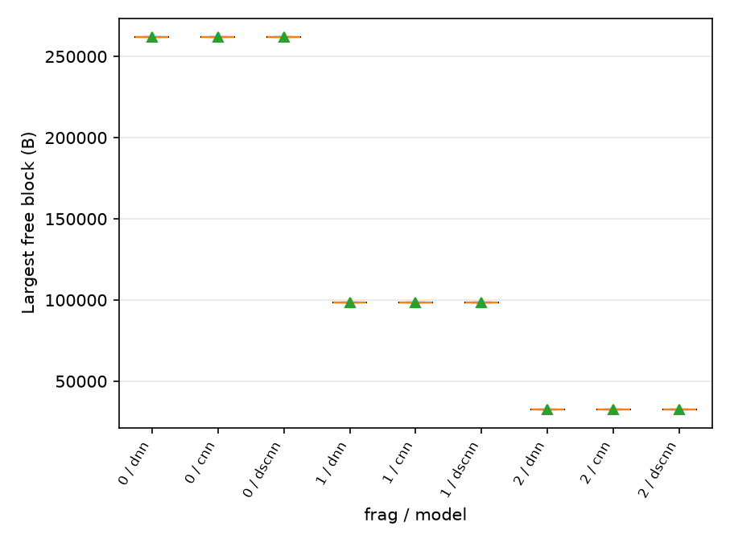
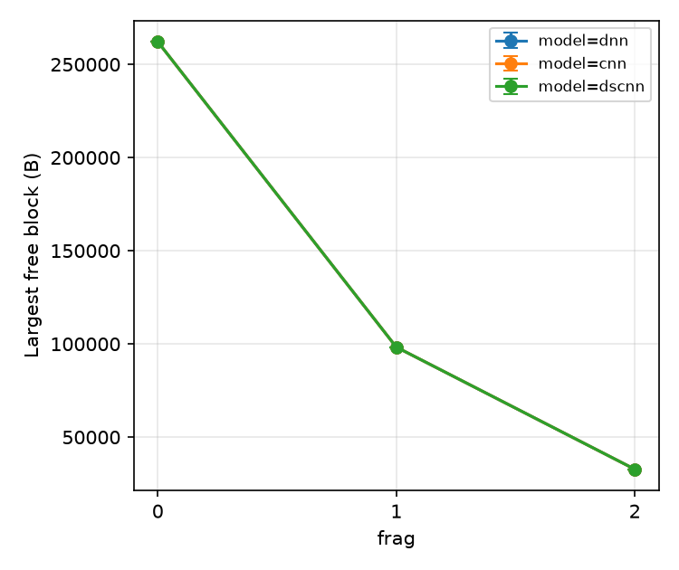

# Experiment C

Source: `..\experiments\results\C`. Factors: `frag`, `model`. Runs: 9 recorded, 9 ok (ok: 9). Each observation is the summary of one run (no pseudoreplication); failed runs are excluded.

**Allocation failures** (a result, not an error): 2 / cnn (1), 0 / dscnn (1), 2 / dscnn (1), 1 / dscnn (1)

## Largest free block (B) (`heap_largest_block`)

### Descriptive statistics per treatment

| frag | model | n | mean | sd | ci95_low | ci95_high | p95 | max |
| --- | --- | --- | --- | --- | --- | --- | --- | --- |
| 0 | dnn | 1 | 2.621e+05 |  |  |  | 2.621e+05 | 2.621e+05 |
| 0 | cnn | 1 | 2.621e+05 |  |  |  | 2.621e+05 | 2.621e+05 |
| 0 | dscnn | 1 | 2.621e+05 |  |  |  | 2.621e+05 | 2.621e+05 |
| 1 | dnn | 1 | 9.83e+04 |  |  |  | 9.83e+04 | 9.83e+04 |
| 1 | cnn | 1 | 9.83e+04 |  |  |  | 9.83e+04 | 9.83e+04 |
| 1 | dscnn | 1 | 9.83e+04 |  |  |  | 9.83e+04 | 9.83e+04 |
| 2 | dnn | 1 | 3.277e+04 |  |  |  | 3.277e+04 | 3.277e+04 |
| 2 | cnn | 1 | 3.277e+04 |  |  |  | 3.277e+04 | 3.277e+04 |
| 2 | dscnn | 1 | 3.277e+04 |  |  |  | 3.277e+04 | 3.277e+04 |

### Factorial ANOVA (main effects only (1 run per treatment), Type III)

| term | df | sum_sq | F | p | partial_eta2 | significant |
| --- | --- | --- | --- | --- | --- | --- |
| frag | 2 | 8.375e+10 | 9.417e+30 | 4.511e-62 | 1 | True |
| model | 2 | 2.938e-21 | 0.3304 | 0.7366 | 0.1418 | False |
| Residual | 4 | 1.779e-20 |  |  |  | False |

Assumptions: Shapiro-Wilk on residuals p = 0.0336, Levene (median) p = n/a (needs 2+ runs per treatment) -> **not met**.

#### Same ANOVA on log(response)

| term | df | F | p | partial_eta2 | significant |
| --- | --- | --- | --- | --- | --- |
| frag | 2 | 3.43e+29 | 3.401e-59 | 1 | True |
| model | 2 | 1.28 | 0.3719 | 0.3902 | False |
| Residual | 4 |  |  |  | False |

Assumptions on the log scale: Shapiro-Wilk p = 0.364, Levene p = n/a (needs 2+ runs per treatment) -> OK.

Kruskal-Wallis across treatments (non-parametric check): H = 8, p = 0.433.

### Tukey HSD on significant terms

**frag**: 3 of 3 pairs differ ([all pairs](heap_largest_block_tukey_frag.csv)).

| group1 | group2 | mean_diff | p_adj | lower | upper | significant |
| --- | --- | --- | --- | --- | --- | --- |
| 0 | 1 | -1.638e+05 | 0 | -1.638e+05 | -1.638e+05 | True |
| 0 | 2 | -2.294e+05 | 0 | -2.294e+05 | -2.294e+05 | True |
| 1 | 2 | -6.554e+04 | 0 | -6.554e+04 | -6.554e+04 | True |

## Proportions (quasi-binomial logistic regression)

- loss: no variation or not estimable.
