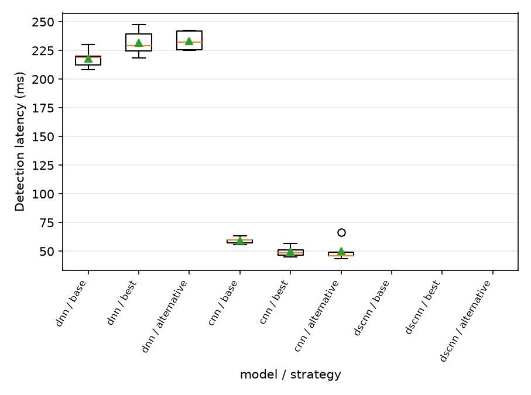
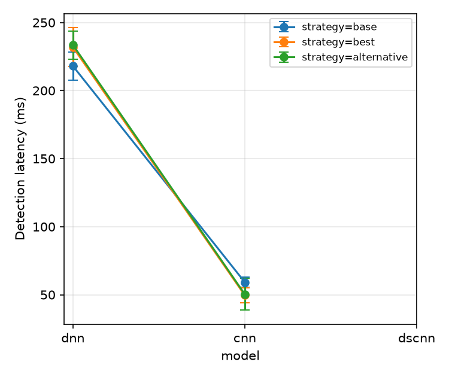
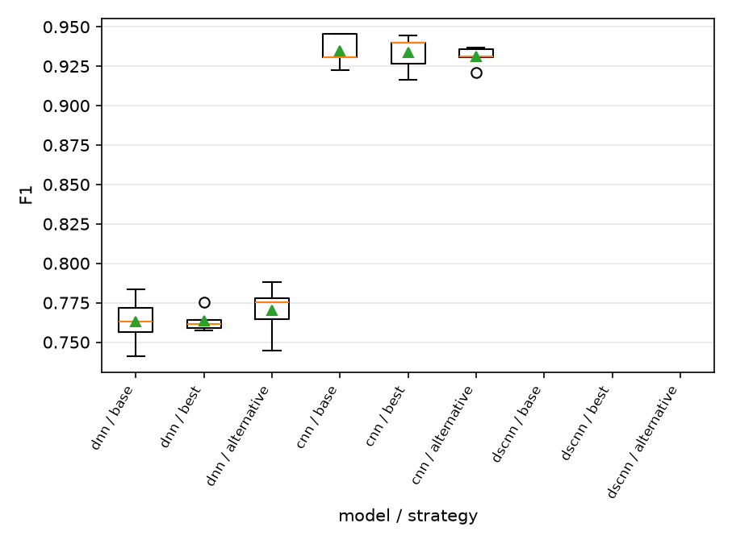
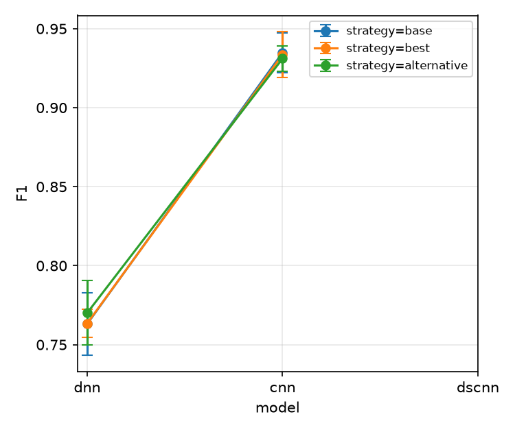

# Experiment D

Source: `..\experiments\results\D`. Factors: `model`, `strategy`. Runs: 45 recorded, 45 ok (ok: 45). Each observation is the summary of one run (no pseudoreplication); failed runs are excluded.

**Allocation failures** (a result, not an error): dscnn / best (5), dscnn / base (5), dscnn / alternative (5)

## Detection latency (ms) (`det_latency_ms`)

### Descriptive statistics per treatment

| model | strategy | n | mean | sd | ci95_low | ci95_high | p95 | max |
| --- | --- | --- | --- | --- | --- | --- | --- | --- |
| dnn | base | 5 | 218.1 | 8.333 | 207.7 | 228.4 | 228.2 | 230.2 |
| dnn | best | 5 | 232 | 11.54 | 217.6 | 246.3 | 245.8 | 247.4 |
| dnn | alternative | 5 | 233.5 | 8.321 | 223.2 | 243.9 | 242.3 | 242.5 |
| cnn | base | 5 | 59.22 | 2.895 | 55.62 | 62.81 | 62.62 | 63.27 |
| cnn | best | 5 | 49.58 | 4.494 | 44 | 55.16 | 55.5 | 56.61 |
| cnn | alternative | 5 | 50.36 | 9.306 | 38.81 | 61.91 | 63.15 | 66.59 |
| dscnn | base | 0 |  |  |  |  |  |  |
| dscnn | best | 0 |  |  |  |  |  |  |
| dscnn | alternative | 0 |  |  |  |  |  |  |

> ANOVA on the complete part of the design, without `model = dscnn`: those treatments have no value for this response (allocation failure or no detection), so the full factorial model is not estimable. They stay in the table above.

### Factorial ANOVA (with all interactions, Type III)

| term | df | sum_sq | F | p | partial_eta2 | significant |
| --- | --- | --- | --- | --- | --- | --- |
| model | 1 | 2.292e+05 | 3553 | 1.346e-27 | 0.9933 | True |
| strategy | 2 | 56.56 | 0.4384 | 0.6501 | 0.03525 | False |
| model x strategy | 2 | 956 | 7.411 | 0.003116 | 0.3818 | True |
| Residual | 24 | 1548 |  |  |  | False |

Assumptions: Shapiro-Wilk on residuals p = 0.295, Levene (median) p = 0.437 -> OK.

### Tukey HSD on significant terms

**model x strategy**: 9 of 15 pairs differ ([all pairs](det_latency_ms_tukey_model_x_strategy.csv)).

| group1 | group2 | mean_diff | p_adj | lower | upper | significant |
| --- | --- | --- | --- | --- | --- | --- |
| cnn / alternative | dnn / alternative | 183.2 | 0 | 167.5 | 198.9 | True |
| cnn / alternative | dnn / base | 167.7 | 0 | 152 | 183.4 | True |
| cnn / alternative | dnn / best | 181.6 | 0 | 165.9 | 197.3 | True |
| cnn / base | dnn / alternative | 174.3 | 0 | 158.6 | 190 | True |
| cnn / base | dnn / base | 158.8 | 0 | 143.1 | 174.5 | True |
| cnn / base | dnn / best | 172.7 | 0 | 157 | 188.4 | True |
| cnn / best | dnn / alternative | 184 | 0 | 168.3 | 199.7 | True |
| cnn / best | dnn / base | 168.5 | 0 | 152.8 | 184.2 | True |
| cnn / best | dnn / best | 182.4 | 0 | 166.7 | 198.1 | True |

**model**: 1 of 1 pairs differ ([all pairs](det_latency_ms_tukey_model.csv)).

| group1 | group2 | mean_diff | p_adj | lower | upper | significant |
| --- | --- | --- | --- | --- | --- | --- |
| cnn | dnn | 174.8 | 0 | 167.6 | 182 | True |

## Audio blocks lost (%) (`loss_pct`)

### Descriptive statistics per treatment

| model | strategy | n | mean | sd | ci95_low | ci95_high | p95 | max |
| --- | --- | --- | --- | --- | --- | --- | --- | --- |
| dnn | base | 5 | 0 | 0 | 0 | 0 | 0 | 0 |
| dnn | best | 5 | 0 | 0 | 0 | 0 | 0 | 0 |
| dnn | alternative | 5 | 0 | 0 | 0 | 0 | 0 | 0 |
| cnn | base | 5 | 0 | 0 | 0 | 0 | 0 | 0 |
| cnn | best | 5 | 0 | 0 | 0 | 0 | 0 | 0 |
| cnn | alternative | 5 | 0 | 0 | 0 | 0 | 0 | 0 |
| dscnn | base | 0 |  |  |  |  |  |  |
| dscnn | best | 0 |  |  |  |  |  |  |
| dscnn | alternative | 0 |  |  |  |  |  |  |

No variation in this response: ANOVA not applicable.

## F1 (`f1`)

### Descriptive statistics per treatment

| model | strategy | n | mean | sd | ci95_low | ci95_high | p95 | max |
| --- | --- | --- | --- | --- | --- | --- | --- | --- |
| dnn | base | 5 | 0.7631 | 0.01593 | 0.7433 | 0.7829 | 0.7811 | 0.7835 |
| dnn | best | 5 | 0.7635 | 0.007146 | 0.7546 | 0.7723 | 0.7732 | 0.7755 |
| dnn | alternative | 5 | 0.7701 | 0.01637 | 0.7498 | 0.7904 | 0.7859 | 0.7879 |
| cnn | base | 5 | 0.9349 | 0.01011 | 0.9223 | 0.9474 | 0.9453 | 0.9453 |
| cnn | best | 5 | 0.9336 | 0.01175 | 0.919 | 0.9482 | 0.9438 | 0.9447 |
| cnn | alternative | 5 | 0.9311 | 0.006329 | 0.9232 | 0.9389 | 0.9365 | 0.9366 |
| dscnn | base | 0 |  |  |  |  |  |  |
| dscnn | best | 0 |  |  |  |  |  |  |
| dscnn | alternative | 0 |  |  |  |  |  |  |

> ANOVA on the complete part of the design, without `model = dscnn`: those treatments have no value for this response (allocation failure or no detection), so the full factorial model is not estimable. They stay in the table above.

### Factorial ANOVA (with all interactions, Type III)

| term | df | sum_sq | F | p | partial_eta2 | significant |
| --- | --- | --- | --- | --- | --- | --- |
| model | 1 | 0.2107 | 1482 | 4.365e-23 | 0.9841 | True |
| strategy | 2 | 2.368e-05 | 0.08327 | 0.9204 | 0.006892 | False |
| model x strategy | 2 | 0.0001678 | 0.59 | 0.5621 | 0.04687 | False |
| Residual | 24 | 0.003413 |  |  |  | False |

Assumptions: Shapiro-Wilk on residuals p = 0.679, Levene (median) p = 0.646 -> OK.

### Tukey HSD on significant terms

**model**: 1 of 1 pairs differ ([all pairs](f1_tukey_model.csv)).

| group1 | group2 | mean_diff | p_adj | lower | upper | significant |
| --- | --- | --- | --- | --- | --- | --- |
| cnn | dnn | -0.1676 | 0 | -0.1761 | -0.1591 | True |

## Proportions (quasi-binomial logistic regression)

- loss: no variation or not estimable.

### missed keywords (`misses` / `keywords`)

Without `model = dscnn` (no runs to count).

| term | chi2 | df | p | significant |
| --- | --- | --- | --- | --- |
| model | 306.1 | 1 | 1.523e-68 | True |
| strategy | 0.07475 | 2 | 0.9633 | False |
| model x strategy | 3.35 | 2 | 0.1873 | False |
